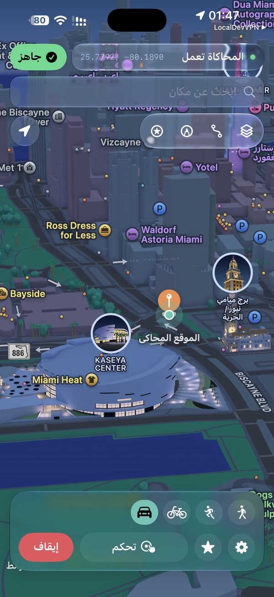
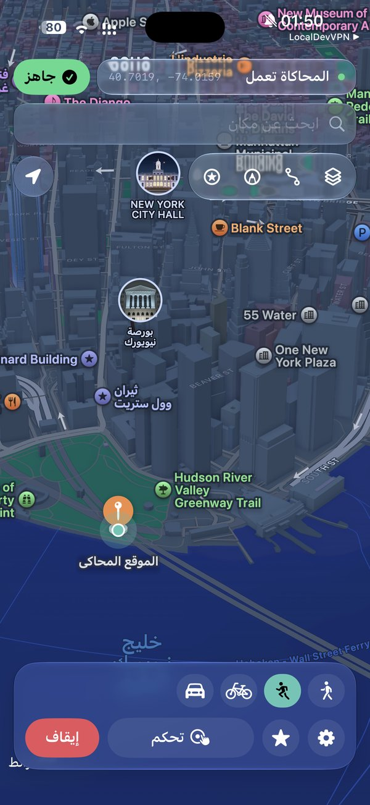
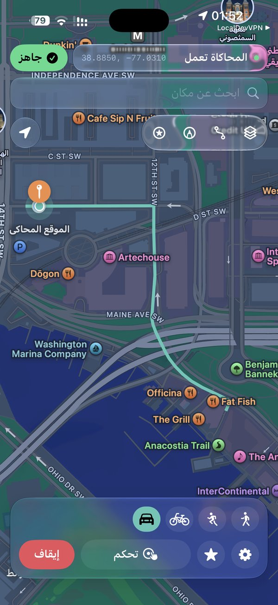

# AnyGPS

**Version 1.0.20**

[**Download IPA · v1.0.20**](https://github.com/otudi/Any-GPS/raw/main/AnyGPS-1.0.20.ipa)

[English](#english) · [العربية](#العربية)

  
  
  
  

## English

AnyGPS changes your iPhone's location easily. Tap the map, search for a place, or follow a route — AnyGPS sends the coordinates through Apple's **developer location service**, so Maps and other apps see the new location as the phone's real GPS.

Arabic and English interface.

### Features

- One-tap teleport (map pin or place search)
- Joystick — walk / run / cycle / drive with natural speed changes
- Routes on real roads and footpaths, or draw your own path
- Import / export GPX routes
- Favorites and recent places
- **Check** button that shows when everything is ready (red → green)
- Keeps working in the background, with alerts if it stops
- Everything stays on your iPhone — no accounts, no analytics

### Requirements

- iPhone on **iOS 27** (pairs on the phone) or **iOS 18–26** (needs a pairing file from a computer once — see [SETUP-iOS18-26.md](SETUP-iOS18-26.md))
- A signing app to install the IPA (Developer Mode is already on when you use one)
- **[LocalDevVPN](https://apps.apple.com/us/app/localdevvpn/id6755608044)** from the App Store (free)
- **Wi‑Fi** for setup and the first teleport

### Install

Download the IPA above, sign it and install it. Then follow **[SETUP.md](SETUP.md#english)** — the first-time activation takes about two minutes.

### Daily use

1. Turn on LocalDevVPN.
2. Open AnyGPS. If the **Check** button at the top is red, tap it and wait until it turns green.
3. Tap the map (or search) to drop a pin, then tap **Teleport**.
4. Tap **Stop** to go back to your real location.

### How it works

AnyGPS pairs once with your iPhone, then uses the open-source [idevice](https://github.com/jkcoxson/idevice) library to talk to Apple's developer location service — the same kind of mechanism Xcode uses. LocalDevVPN provides the local tunnel that makes this possible without a computer.

### Pokémon GO and similar games

AnyGPS changes the location the whole system reports. Apps that trust the system location (Apple Maps and most apps) follow it. **Pokémon GO** runs its own checks and often rejects developer-simulated locations ("Failed to detect location"). That is expected with this method and is not a bug. AnyGPS is not a game client or an anti-cheat bypass.

## العربية

تطبيق يغيّر موقع الآيفون بسهولة: اضغط على الخريطة أو ابحث عن مكان، وسيظهر موقعك الجديد في الخرائط وباقي التطبيقات.

الواجهة بالعربي والإنجليزي.

### المميزات

- انتقال بضغطة واحدة (دبوس على الخريطة أو بحث عن مكان)
- عصا تحكم — مشي، جري، دراجة، قيادة، بسرعة طبيعية متغيرة
- مسارات على الطرق والممرات الحقيقية، أو ارسم مسارك بنفسك
- استيراد وتصدير مسارات GPX
- المفضلة والأماكن الأخيرة
- زر **افحص الاتصال** يوضح متى يكون كل شيء جاهزًا (أحمر ← أخضر)
- يستمر في الخلفية، وينبهك إذا توقف
- كل شيء يبقى على جوالك — بدون حسابات ولا تتبع

### المتطلبات

- آيفون بنظام <strong dir="ltr">iOS 27</strong> (الإقران من الجوال نفسه) أو <strong dir="ltr">iOS 18–26</strong> (يحتاج ملف إقران من الكمبيوتر مرة وحدة — راجع <a dir="ltr" href="SETUP-iOS18-26.md">SETUP-iOS18-26.md</a>)
- تطبيق توقيع لتثبيت ملف IPA (نمط المطور يكون مفعّلًا مسبقًا عند استخدامه)
- تطبيق **<a dir="ltr" href="https://apps.apple.com/us/app/localdevvpn/id6755608044">LocalDevVPN</a>** من App Store (مجاني)
- **واي فاي** أثناء الإعداد وأول انتقال

### التثبيت

نزّل ملف IPA من الرابط أعلاه، ووقّعه وثبّته. بعدها اتبع **<a dir="ltr" href="SETUP.md#العربية">SETUP.md</a>** — التفعيل لأول مرة يأخذ حوالي دقيقتين.

### الاستخدام اليومي

1. شغّل LocalDevVPN.
2. افتح AnyGPS. إذا كان زر **افحص الاتصال** في الأعلى أحمر، اضغطه وانتظر حتى يصير أخضر.
3. اضغط على الخريطة (أو ابحث) لوضع دبوس، ثم اضغط **انتقال**.
4. اضغط **إيقاف** للرجوع إلى موقعك الحقيقي.

### كيف يعمل

يقترن AnyGPS مع الآيفون مرة واحدة، ثم يستخدم مكتبة <a dir="ltr" href="https://github.com/jkcoxson/idevice">idevice</a> مفتوحة المصدر للتواصل مع خدمة الموقع الخاصة بالمطوّرين من Apple — نفس نوع الآلية التي يستخدمها Xcode. ويوفّر LocalDevVPN النفق المحلي الذي يجعل ذلك ممكنًا بدون كمبيوتر.

### بوكيمون جو والألعاب المشابهة

بعض الألعاب مثل **بوكيمون جو** لها حماية خاصة، وغالبًا ترفض الموقع المغيّر. هذا طبيعي مع هذه الطريقة وليس خللًا في التطبيق.

الخرائط وباقي التطبيقات تعمل بدون مشكلة.

## License

[MIT](LICENSE). Based on [Locus](https://github.com/ChrisMack32/Locus).
